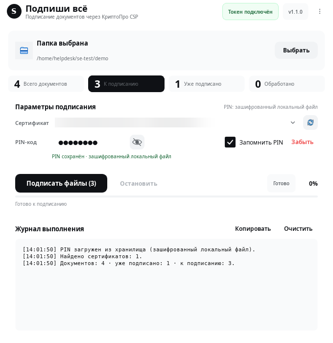

# Подпиши всё (Sign Everything) 1.1.0

Компактное GUI-приложение для массового подписания файлов отсоединённой
подписью через `cryptcp` из КриптоПро CSP.



## Возможности

- компактное вертикальное окно 680×700;
- интерфейс в стиле **DeepSeek Harness**: монохромная светлая тема, тонкие границы, системный шрифт, компактные карточки и overflow-меню;
- перетаскивание папки в окно или выбор через диалог;
- рекурсивная обработка вложенных папок;
- Подсчёт: всего документов, уже подписанных, к подписанию, обработано;
- не трогает готовые `.sig` и временные `.sig.tmp`;
- загрузка сертификатов из `certmgr -list -u`;
- просроченные сертификаты, если они есть в хранилище, помечаются в списке;
- индикатор подключённого токена;
- массовое подписание с прогрессом и журналом;
- запоминание PIN-кода;
- запоминание последней папки, сертификата и размера окна;
- прокрутка при уменьшении высоты окна.


## Требования

- Linux x86_64 (проверено на Astra Linux 1.8.6);
- Python 3.8+;
- PyQt5;
- `cryptography` — для зашифрованного локального хранилища PIN;
- КриптоПро CSP 5.0 с `cryptcp` и `certmgr`;
- подключённый токен/смарт-карта с сертификатом и контейнером.

На Astra Linux зависимости ставятся из репозитория:

```bash
sudo apt update
sudo apt install python3-pyqt5 python3-cryptography
```

Либо через `pip` в виртуальном окружении:

```bash
python3 -m venv .venv
. .venv/bin/activate
pip install -r requirements.txt
```

## Установка пакетов

### DEB

```bash
sudo dpkg -i dist/sign-everything_1.1.0_all.deb
sudo apt -f install
```


### RPM

```bash
sudo rpm -Uvh dist/sign-everything-1.1.0-1.noarch.rpm
```

Имена пакетов Python-зависимостей зависят от дистрибутива. В RPM указаны
`python3-qt5` и `python3-cryptography`; для ALT Linux может потребоваться
`python3-module-PyQt5`. При необходимости установите зависимости вручную.


## Запуск из исходников

```bash
git clone https://github.com/Tripswarlock/sign-everything.git
cd sign-everything
python3 Sign-everything.py
```

Если КриптоПро установлен в нестандартный каталог:

```bash
CRYPTCP_PATH=/path/to/cryptcp CERTMGR_PATH=/path/to/certmgr python3 Sign-everything.py
```

## Как работает подписание

Для каждого документа без парного `.sig` выполняется:

```text
cryptcp -sign -detach -dn "CN=..." <файл> <файл>.sig.tmp
```

PIN-код передаётся `cryptcp` параметром `-pin` — это совместимо с текущими
сборками КриптоПро CSP. На машине с несколькими пользователями PIN может быть
виден в списке процессов; запускайте приложение под отдельной учётной записью.
Готовая подпись переименовывается
из `.sig.tmp` в `.sig`; при ошибке временный файл удаляется.

## Хранение PIN-кода


Используются два варианта:

1. **Системный keyring**, если установлен `python3-keyring` и доступен
   Secret Service/KWallet. Это предпочтительный вариант.
2. **Зашифрованный локальный файл**, если keyring недоступен:
   - `~/.config/sign-everything/pin.vault` — шифротекст Fernet;
   - `~/.local/share/sign-everything/vault.key` — случайный ключ, права `0600`.

