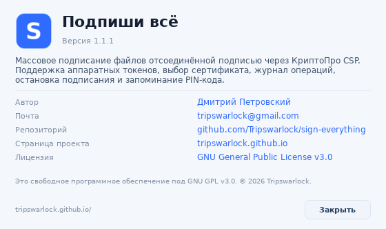

# Подпиши всё (Sign Everything) 1.1.1

Компактное GUI-приложение для массового подписания файлов отсоединённой
подписью через `cryptcp` из КриптоПро CSP. Работает локально: документы и
PIN-код не покидают компьютер.


## Возможности

- компактное вертикальное окно 680×700;
- перетаскивание папки в окно или выбор через диалог;
- рекурсивная обработка вложенных папок;
- точный подсчёт: всего документов, уже подписанных, к подписанию, обработано;
- не трогает готовые `.sig` и временные `.sig.tmp`;
- загрузка сертификатов из `certmgr -list -u`;
- просроченные сертификаты, если они есть в хранилище, помечаются в списке;
- индикатор подключённого токена;
- массовое подписание с прогрессом и журналом;
- остановка текущего процесса `cryptcp`, а не только очереди;
- запоминание PIN-кода с явной галочкой «Запомнить PIN»;
- кнопка «Забыть» для удаления сохранённого PIN;
- меню «Справка → О программе» с автором, ссылками и лицензией;
- запоминание последней папки, сертификата и размера окна;
- прокрутка при уменьшении высоты окна.



## Требования

- Linux x86_64 (проверено на Astra Linux 1.8.6);
- Python 3.8+;
- PyQt5;
- `cryptography` — для зашифрованного локального хранилища PIN;
- КриптоПро CSP 5.0 с `cryptcp` и `certmgr`;
- подключённый токен/смарт-карта с сертификатом и контейнером.

На Astra Linux зависимости ставятся из репозитория:

```bash
sudo apt update
sudo apt install python3-pyqt5 python3-cryptography
```

Либо через `pip` в виртуальном окружении:

```bash
python3 -m venv .venv
. .venv/bin/activate
pip install -r requirements.txt
```

## Установка пакетов

### DEB

```bash
sudo dpkg -i dist/sign-everything_1.1.1_all.deb
sudo apt -f install
```

Запуск из меню «Офис → Подпиши всё» или командой:

```bash
sign-everything
```

### RPM

```bash
sudo rpm -Uvh dist/sign-everything-1.1.1-1.noarch.rpm
```

Имена пакетов Python-зависимостей зависят от дистрибутива. В RPM указаны
`python3-qt5` и `python3-cryptography`; для ALT Linux может потребоваться
`python3-module-PyQt5`. При необходимости установите зависимости вручную.

## Сборка пакетов

Требуются `dpkg-deb` и `rpmbuild`.

```bash
bash packaging/build-all.sh
```

Результат:

```text
dist/sign-everything_1.1.1_all.deb
dist/sign-everything-1.1.1-1.noarch.rpm
```

Отдельно:

```bash
bash packaging/build-deb.sh
bash packaging/build-rpm.sh
```

Пакеты устанавливают:

```text
/usr/bin/sign-everything
/usr/share/sign-everything/Sign-everything.py
/usr/share/applications/sign-everything.desktop
/usr/share/icons/hicolor/256x256/apps/sign-everything.png
/usr/share/doc/sign-everything/
```

## Запуск из исходников

```bash
git clone https://github.com/Tripswarlock/sign-everything.git
cd sign-everything
python3 Sign-everything.py
```

Если КриптоПро установлен в нестандартный каталог:

```bash
CRYPTCP_PATH=/path/to/cryptcp CERTMGR_PATH=/path/to/certmgr python3 Sign-everything.py
```

## Как работает подписание

Для каждого документа без парного `.sig` выполняется:

```text
cryptcp -sign -detach -dn "CN=..." <файл> <файл>.sig.tmp
```

PIN-код передаётся `cryptcp` через стандартный ввод. Он не попадает в аргументы
командной строки и не виден в `ps`. Готовая подпись атомарно переименовывается
из `.sig.tmp` в `.sig`; при ошибке временный файл удаляется.

## Хранение PIN-кода

PIN сохраняется **только после первого успешного подписания** — так случайно
введённый неверный PIN не остаётся в хранилище.

Используются два варианта:

1. **Системный keyring**, если установлен `python3-keyring` и доступен
   Secret Service/KWallet. Это предпочтительный вариант.
2. **Зашифрованный локальный файл**, если keyring недоступен:
   - `~/.config/sign-everything/pin.vault` — шифротекст Fernet;
   - `~/.local/share/sign-everything/vault.key` — случайный ключ, права `0600`.

Ключ шифрования дополнительно привязан к `/etc/machine-id`, UID и имени
компьютера. PIN не хранится в открытом виде. Файл `pin.vault`, перенесённый на
другую машину, расшифровать нельзя.

Важно: локальный зашифрованный файл защищает от случайного просмотра, но не
является заменой аппаратному keyring. Пользователь с доступом к учётной записи
и правами root теоретически может добраться до секрета. Для рабочего места с
повышенными требованиями используйте системный keyring и блокировку сеанса.

Снять галочку «Запомнить PIN» или нажать «Забыть» — удалить сохранённый PIN.
Текущее поле при снятии галочки не очищается, чтобы можно было подписать файлы
в этом сеансе.

## Проверка на Astra Linux + токен

Проверено 09.11.2026 в VirtualBox:

- Astra Linux 1.8.6, ядро `6.1.166-1-generic`, Python 3.11.2;
- КриптоПро CSP 5.0.13000;
- токен JaCarta (ARDS, USB `24dc:0101`);
- сертификат ГОСТ Р 34.10-2012 256 бит.

Результат:

- приложение загрузило сертификат с токена;
- подписаны 3 тестовых документа, включая файл во вложенной папке;
- все три подписи проверены командой
  `cryptcp -verify -detach <файл> <файл>.sig` — код возврата `0`,
  «Signature's verified»;
- PIN сохранён, при повторном запуске автоматически загружен в защищённое поле;
- поиск строки PIN в каталогах конфигурации не нашёл открытого текста;
- права на `pin.vault` и `vault.key` — `0600`;
- интерфейс проверен при 680×700; при 680×560 появляется прокрутка;
- DEB-пакет установлен на Astra, приложение запущено из
  `/usr/bin/sign-everything`, подписание и сохранение PIN проверены;
- RPM-пакет собран, проверены метаданные и список файлов.

## Ограничения

- Приложение рассчитано на Linux-пути КриптоПро CSP; для другой ОС потребуется
  адаптация путей и работы с токеном.
- Выбор сертификата выполняется по CN через `-dn`. Если на токене несколько
  сертификатов с одинаковым CN, нужен более точный селектор.
- Для работы токена должен быть доступен PC/SC (`pcscd`).
- PIN всё равно находится в оперативной памяти приложения во время подписания.

## Лицензия

Sign Everything распространяется по **GNU General Public License v3.0**
(`GPL-3.0-only`). Полный текст — в файле [LICENSE](LICENSE).

## Автор

Дмитрий Петровский

- GitHub: https://github.com/Tripswarlock
- Почта: tripswarlock@gmail.com
- Проект: https://github.com/Tripswarlock/sign-everything
- Страница: https://tripswarlock.github.io/
